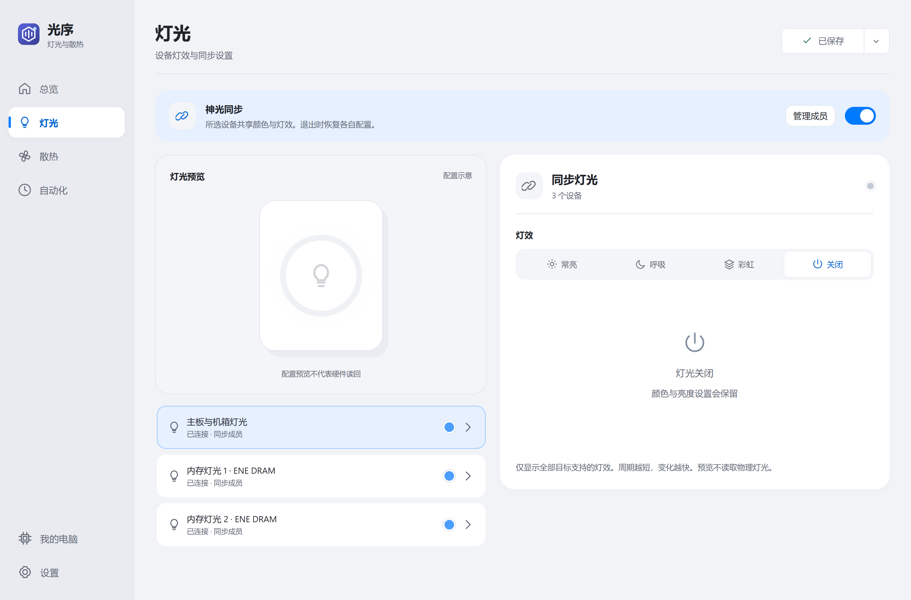
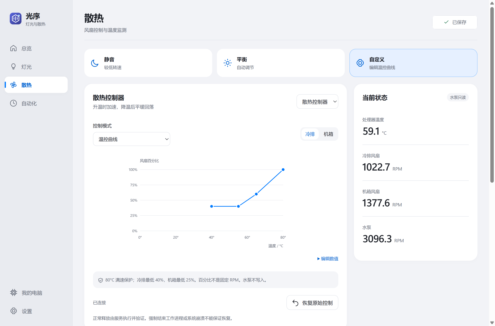
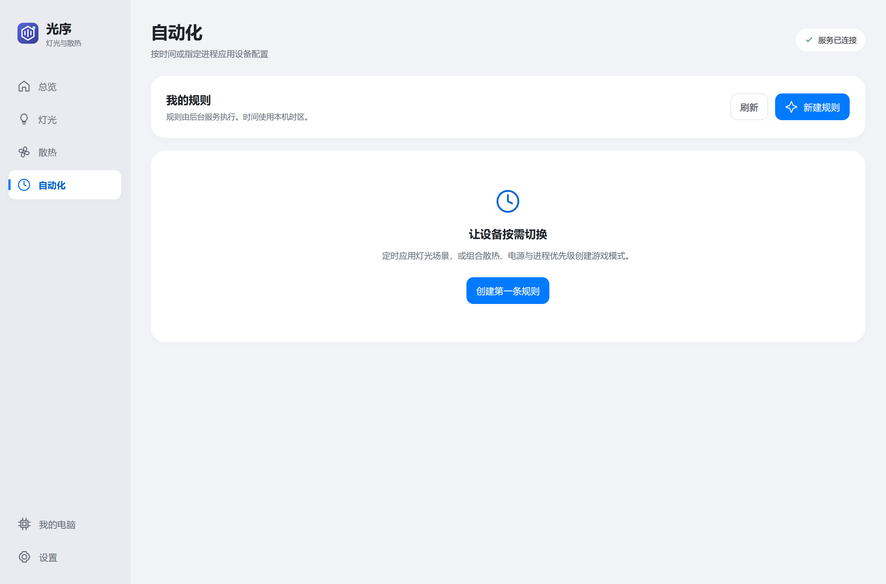
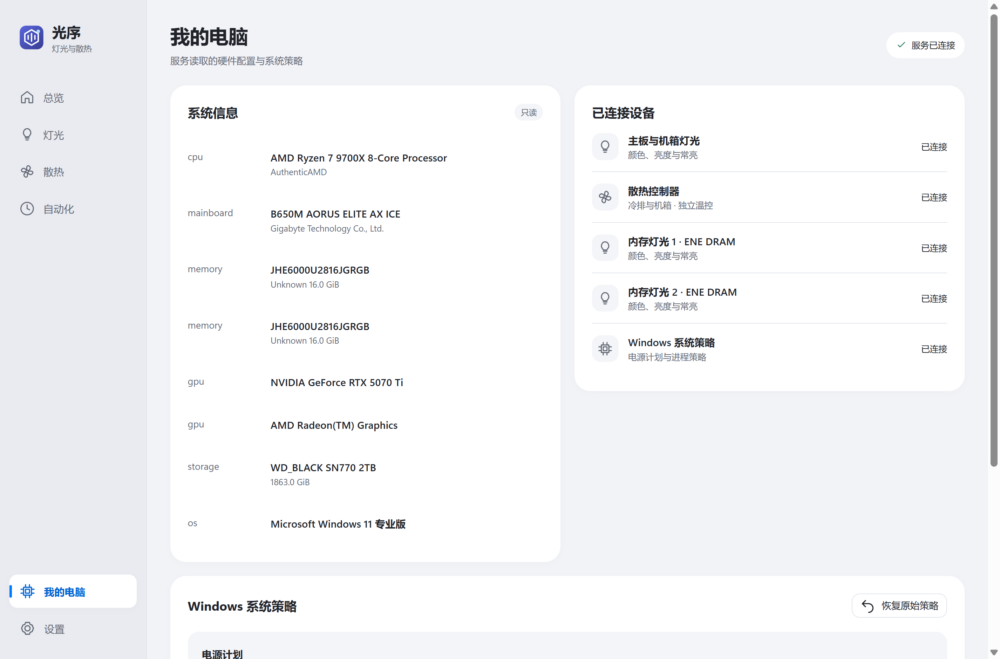

# 光序 · LightOrder

**Windows 灯光、散热、自动化与系统控制工具。**

[English](README.md) · [开始使用](docs/zh-CN/getting-started.md) · [自动化](docs/zh-CN/automation.md) · [硬件支持](docs/zh-CN/hardware-support.md) · [插件开发](docs/zh-CN/plugin-development.md)

光序把受支持的电脑灯光、持续且保留保护的风扇控制、实时遥测和 Windows 策略放在同一个桌面应用中。设备适配器在本地服务管理的独立进程中运行。界面根据设备声明的能力提供操作，新适配器可以复用现有控件，无需添加厂商判断。

## 获取光序

[Releases](https://github.com/adrianfrin/LightOrder/releases) 提供安装包时，请下载 Windows x64 **`LightOrder-win-x64.exe`**。源码与 CI 产物不等于已验收发行版；安装及硬件验证范围以发布说明为准。

- 目标平台为 **Windows 11 x64**。
- 安装前需要 [Microsoft Edge WebView2 Runtime](https://developer.microsoft.com/microsoft-edge/webview2/)。自包含包已包含 .NET。
- 首次安装需要管理员授权来安装服务与插件，之后日常设备操作无需逐次 UAC。安装、修复、更新和卸载仍可能需要提权。
- ENE 内存灯光需要兼容的 OpenRGB 与 PawnIO，是否随包提供取决于发行版，详见[依赖与安装](docs/zh-CN/getting-started.md)。

单个下载文件会安装多个组件到 `%ProgramFiles%\LightOrder`。安装后的启动器名为 `LightOrder.exe`。

## 功能

- **灯光：** 合格设备支持静态、呼吸、彩虹、亮度与关闭。显式同步组保留成员已知独立设置；保存的场景可用于自动化。
- **散热：** 持续运行独立冷排/机箱曲线，或保留高温保护的手动占空比；查看温度与转速历史，主动恢复控制。写入仅开放给允许列表内的主板与通道。
- **自动化：** 准确的本地分钟定时与精确进程触发，可组合灯光场景、散热预设、电源计划和受支持的进程策略。服务通过持久化日志实现至多一次派发，并显示暂停状态。详见[自动化](docs/zh-CN/automation.md)。
- **我的电脑：** 读取硬件信息，选择 Windows 电源计划，设置支持的进程优先级和亲和性。
- **本地服务：** 受保护安装、按账户限制的命名管道、独立插件进程与操作诊断。关闭窗口隐藏到托盘；退出界面后服务仍运行。
- **偏好：** 中英文、外观，以及分别控制灯光和散热的启动恢复选项。两个恢复选项默认关闭。

呼吸和彩虹由服务生成静态帧，目标 **每秒 4 帧**，最多 **16 台设备**，周期为 2–60 秒。设备延迟可能降低实际帧率。退出界面后仍可运行；某台设备的帧失败后停止该效果，不自动重试。

界面设计参考 [FlClash](https://github.com/chen08209/FlClash)（GPL-3.0 项目）。此处致谢设计灵感，不表示复制了 FlClash 代码。详见[第三方声明](THIRD-PARTY-NOTICES.md)。

## 应用截图

以下为 0.2 实现连接本机硬件服务后的原生 Windows App 截图。灯光预览展示配置，不代表物理颜色读回。

[](docs/images/lighting.png)

*灯光：设备、效果、亮度与显式同步。*

[](docs/images/cooling.png)

*散热：冷排/机箱设置及温度与转速历史。*

[](docs/images/automation.png)

*自动化：本地定时与精确进程规则。*

[](docs/images/computer.png)

*我的电脑：硬件信息与可用系统策略。*

## 硬件范围与控制限制

| 项目 | 当前范围 |
| --- | --- |
| 主板灯光 | IT5702 适配器，写入前校验身份。开发机已有静态/关闭的历史实物观察。 |
| OpenRGB 灯光 | SDK v3，默认开放 ENE SMBus DRAM。其他实物设备需显式配置检测器和精确设备允许列表。后端缓存不是物理颜色回读。 |
| 显卡、键盘、鼠标等灯光 | 可通过显式配置的 OpenRGB 设备适配接入，不代表全面兼容，也没有新增实物验收证据。 |
| 风扇控制 | 仅 B650M AORUS ELITE AX ICE、IT8689E 实例 0，以及已验证的冷排/机箱通道。其他系统只读或不可用。 |
| 硬件监控 | 可用的 LibreHardwareMonitor 传感器；取决于硬件、驱动和权限。 |

**生产散热现在持续控制，直到释放、关闭或安全故障。** 冷排最低 40%，机箱最低 25%，两者在 80°C 达到 100%。水泵只读。不支持固件或设备持久配置写入。

收到挂起通知或检测到控制间隔后，先恢复，再用新鲜遥测保守重启。持久化恢复意图阻止未解决写入后的不安全接管。强制结束进程、系统崩溃、断电和驱动故障不能保证恢复。新实现的长时间运行与睡眠唤醒硬件测试仍待完成。命令接受或 OpenRGB 缓存匹配不能证明实物变化。详见[支持与证据矩阵](docs/zh-CN/hardware-support.md)和[散热指南](docs/zh-CN/cooling.md)。

## 从源码构建

需要 Windows、PowerShell 和 [.NET 10 SDK](https://dotnet.microsoft.com/download/dotnet/10.0)，在仓库根目录运行：

```powershell
dotnet build src/LightOrder.App/LightOrder.App.csproj -c Release
dotnet build src/LightOrder.Service/LightOrder.Service.csproj -c Release
dotnet run --project tests/LightOrder.Service.Tests/LightOrder.Service.Tests.csproj -c Release
dotnet run --project tests/LightOrder.Automation.Tests/LightOrder.Automation.Tests.csproj -c Release
```

生成自包含安装包：

```powershell
./scripts/Publish-Production.ps1 -Dotnet (Get-Command dotnet).Source
```

脚本发布应用、服务及四个生产插件，内部输出为 `artifacts/installer/LightOrder.exe`；公开下载资产名为 `LightOrder-win-x64.exe`。OpenRGB、匹配的检测器清单及已签名 PawnIO 安装程序是可选构建输入。分发前阅读[构建、测试与发布指南](docs/zh-CN/build-and-release.md)。

## 文档与贡献

- [开始使用与故障排查](docs/zh-CN/getting-started.md)
- [自动化：定时与进程规则](docs/zh-CN/automation.md)
- [散热与恢复](docs/zh-CN/cooling.md)
- [硬件支持与验证边界](docs/zh-CN/hardware-support.md)
- [架构与数据位置](docs/zh-CN/architecture.md)
- [插件开发与协议 v1](docs/zh-CN/plugin-development.md)
- [构建、测试与安装包](docs/zh-CN/build-and-release.md)
- [当前验证与历史证据](docs/zh-CN/verification.md)
- [参与贡献](CONTRIBUTING.md) · [安全政策](SECURITY.md)

欢迎在 [Issues](https://github.com/adrianfrin/LightOrder/issues) 报告问题或建议硬件支持。请提供应用/插件版本，区分软件回读与实物观察，不要公开个人标识或安全漏洞利用细节。

## 许可证

LightOrder 使用 **GNU GPL-3.0-or-later**。IT5702 实现派生自 liquidctl 并保留来源声明。LibreHardwareMonitor 等 MPL 组件保留原许可；本仓库不会重新授权 OpenRGB 或其他依赖。详见[第三方声明与分发义务](THIRD-PARTY-NOTICES.md)及 [GNU GPL v3 正文](https://www.gnu.org/licenses/gpl-3.0.html)。
